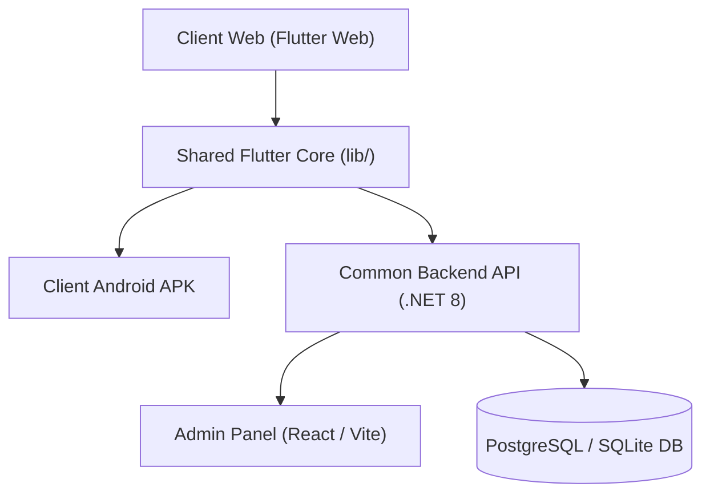

# Client Web Change Impact Matrix

## Overview
This document analyzes the recent changes implemented in the Client Web portal (Flutter Web), maps their architectural footprint, and outlines the required compatibility enhancements across the Admin Panel (React/TypeScript), Common Backend API (.NET 8), and Client Android APK (Flutter Mobile).

---

## 1. Inventory of Recent Client Web Changes

| # | Feature / Change Area | Modified Files / Components | Layer Affected | Business Intent |
|---|------------------------|-----------------------------|----------------|-----------------|
| 1 | **Cross-Platform Invoice PDF Printing** | `lib/utils/invoice_printer.dart`, `lib/utils/printer_helper.dart`, `lib/utils/printer_helper_web.dart` | Shared Client / Mobile UI | Provide seamless, cross-platform PDF generation, print dialogs, and instant previews for sales history, POS receipts, and customer ledgers without browser-only crashes on Android. |
| 2 | **Customer Phone Autofill & Receipt Sharing** | `lib/screens/pos_screen.dart`, `lib/screens/reports_screen.dart`, `lib/screens/sales_history_screen.dart`, `lib/utils/whatsapp_helper.dart` | Shared Client UI & Offline Sync | Multi-key extraction (`customerPhone ?? customerMobile ?? phone ?? mobile`) across billing flows, with automatic fallback resolution from SQLite and Customer Master. |
| 3 | **Double-Entry Customer Ledger System** | `lib/screens/customers_screen.dart`, `lib/database/sqlite_helper.dart` | Client UI & Offline Storage | Display comprehensive credit/debit transaction logs for every sale (Cash, Udhaar, UPI, Split) with 3 KPI cards, transaction breakdowns, and direct WhatsApp / Print statements. |
| 4 | **Dynamic Rate Editing at POS** | `lib/screens/pos_screen.dart` | Client Business Logic & POS | Allow real-time item price/rate override at checkout. Recalculates line totals, discounts, and taxes dynamically while preserving original `stockRate` for margin auditing. |
| 5 | **Tenant SaaS Client Management** | `lib/screens/tenants_screen.dart`, `lib/main.dart` | Client Web & Mobile UI | Full SaaS tenant client management with active/inactive filtering, plan cards, domain tracking, creation, editing, and status toggles matching Admin Panel `TenantsPage.tsx`. |
| 6 | **Direct Cloud WhatsApp Notification Gateway** | `lib/utils/whatsapp_helper.dart`, `lib/providers/notification_provider.dart` | API Integration & Communications | Automatic dispatch of receipts, overdue balance reminders, and marketing campaigns via backend Green-API / UltraMsg endpoints. |
| 7 | **Dynamic Master Management & Dropdowns** | `lib/screens/masters_screen.dart`, `lib/widgets/master_dropdown.dart` | Shared Client UI & Master Data | Real-time creation, editing, and filtering of Categories, UOMs, Item Types, Brands, Payment Modes, Tax Rates, and Expense Categories. |

---

## 2. Change Impact & Compatibility Matrix

| Change Area | Impact on Admin Panel | Impact on Common API | Impact on Android APK | Risk & Mitigation |
|---|---|---|---|---|
| **Invoice Printing** | Enhanced `SalesPage.tsx` print template to display edited rates (`rate || unitPrice || price`) and customer contact number. | Ensure `GET /api/sales` returns normalized item lists with `unitPrice`, `rate`, and customer phone fields. | Use conditional compilation (`if (dart.library.html)`) in `printer_helper.dart` to prevent `dart:html` crashes on Android VM. | **Low Risk**: Resolved by isolating web-specific JS code. |
| **Customer Phone Autofill** | None. Admin already accepts phone and mobile fields. | Ensure `customerMobile` and `customerPhone` aliases are preserved across JSON serializers. | Fully supported in shared Flutter codebase via `SyncProvider` and `SQLiteHelper`. | **Low Risk**: Fallback chain guarantees phone is never blank if stored in master. |
| **Customer Ledger System** | In `CustomersPage.tsx`, enhanced ledger statement modal to display `paymentMode` badges and item summaries. | Endpoint `GET /api/Customers/{identifier}/ledger` already delivers comprehensive sale items and payments. | Full parity achieved via shared `customers_screen.dart` and offline SQLite ledger caching. | **Medium Risk**: Handled by caching ledgers offline when device is disconnected. |
| **Dynamic Rate Editing** | Ensure sales review table respects custom price/rate recorded on each line item. | API `POST /api/sales` and `SaleItem` entity accept `UnitPrice` as recorded rate and calculate line totals accordingly. | Identical POS engine shared between Web and Android APK in `pos_screen.dart`. | **Low Risk**: Calculations match on both platforms. |
| **Tenant Management** | Admin Panel `TenantsPage.tsx` was the reference model. `tenants_screen.dart` built in Flutter for complete parity. | Endpoints `GET /api/tenants`, `POST /api/tenants`, `PUT /api/tenants/{id}`, `DELETE /api/tenants/{id}` utilized. | `tenants_screen.dart` added to mobile routes `/tenants` and accessible via navigation drawer for Admin users. | **Low Risk**: Access restricted to Admin role. |
| **Delete Actions (Items, Stock, Customers)** | Admin Panel already had delete buttons for Items, Stock, and Customers. | Endpoints `DELETE /api/Items/{id}`, `DELETE /api/Stock/{id}`, `DELETE /api/customers/{id}` already exist. | Add confirmation dialogs and delete actions to `items_screen.dart`, `stock_screen.dart`, and `customers_screen.dart`. | **Low Risk**: Confirmation prevents accidental deletions. |
| **Category Sales & Export** | Admin Panel `ReportsPage.tsx` had category sales table and CSV export. | `GET /api/sales` provides item-level data for category grouping. | Add Category Performance breakdown and CSV Export to `reports_screen.dart`. | **Low Risk**: Purely analytical aggregation. |

---

## 3. Action Plan

1. **Shared Flutter Core & Android APK (`VillageShop_Mobile`)**:
   - Register `/tenants` and `/udhaar` in `app_drawer.dart` with role-aware navigation.
   - Update `customers_screen.dart` with `initialTab` parameter, Udhaar risk badges, delete action, and auth headers.
   - Update `items_screen.dart` with top stat cards and delete action.
   - Update `stock_screen.dart` with top stat cards and delete action.
   - Update `reports_screen.dart` with Category Sales breakdown and CSV export.
2. **Admin Panel (`VillageShop_Admin`)**:
   - Enhance `CustomersPage.tsx` ledger modal to display `paymentMode` badge and `itemsSummary`.
   - Update `SalesPage.tsx` print template to display item `rate` and customer phone.
3. **Backend API (`VillageShop_Backend`)**:
   - Verify that all endpoints accept tenant headers and handle soft deletes properly.
4. **Verification**:
   - Run `flutter analyze` and `flutter test`.
   - Run `dotnet test`.
   - Run `npm run build` in Admin Panel.
   - Run `flutter build web --release` and `flutter build apk --debug`.
